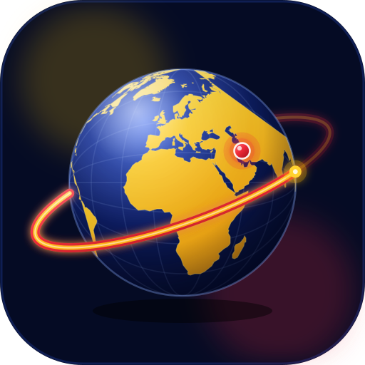

# 🌍 Globe.Lax — کره زمین

**نسخه ۱.۰.۰ · مجوز MIT · © 2025 mohamadreza.lak**

> «این اپلیکیشن جهت آموزش به نوجوانان و جوانان ایران عزیز ساخته شده است.»
>
> *This app was built to teach the teenagers and young people of beloved Iran.*

**طراحی و توسعه: محمدرضا لک (mohamadreza.lak)**

<p align="center">
  
</p>

---

## فهرست

- [دربارهٔ برنامه](#دربارهٔ-برنامه)
- [امکانات](#امکانات)
- [نصب و اجرا](#نصب-و-اجرا)
- [ساخت APK و AAB](#ساخت-apk-و-aab)
- [امضای نسخهٔ انتشار](#امضای-نسخهٔ-انتشار)
- [جایگزینی لوگو](#جایگزینی-لوگو)
- [زیپ کردن پروژه و انتشار در گیت‌هاب](#زیپ-کردن-پروژه-و-انتشار-در-گیت‌هاب)
- [متن‌های آمادهٔ فروشگاه](#متن‌های-آمادهٔ-فروشگاه)
- [دقت اطلاعات و منابع](#دقت-اطلاعات-و-منابع)
- [English](#english)

---

## دربارهٔ برنامه

**Globe.Lax** یک اپلیکیشن **کاملاً آفلاین** و **دوزبانه (فارسی + انگلیسی)** برای یادگیری
**۱۹۵ کشور جهان** است: پرچم، پایتخت، واحد پول (نام + کد ISO)، جمعیت، مساحت، زبان‌ها،
قاره و یک نکتهٔ آموزشی کوتاه — همراه با **کرهٔ زمین تعاملی**، **فلش‌کارت‌های سه‌بعدی**
و **چهار حالت آزمون**.

هدف برنامه آموزش نوجوانان و جوانان ایران عزیز است. برنامه **بدون اینترنت**، **بدون تبلیغ**،
**بدون ردیابی** و **بدون هیچ مجوز (Permission)** کار می‌کند و هیچ داده‌ای از دستگاه خارج نمی‌شود.

## امکانات

| بخش | توضیح |
|---|---|
| 🌐 **کرهٔ زمین تعاملی** | چرخش با انگشت + اینرسی، لمس کشور، نزدیک‌شدن خودکار به کشور انتخاب‌شده، کشیدن با ماوس روی دسکتاپ |
| 🗂️ **۱۹۵ کشور** | ۱۹۳ عضو سازمان ملل + فلسطین + واتیکان؛ پرچم، پایتخت، ارز (نام + کد)، جمعیت، مساحت، زبان، قاره، نکتهٔ آموزشی |
| 🔎 **جستجوی هوشمند** | با نام فارسی/انگلیسی، پایتخت، نام یا کد ارز، کد ISO و زبان؛ نرمال‌سازی «ی/ک/آ» برای جستجوی فارسی راحت |
| 🧭 **فیلتر قاره** | آسیا، اروپا، آفریقا، آمریکای شمالی، آمریکای جنوبی، اقیانوسیه با رنگ اختصاصی |
| 🃏 **فلش‌کارت** | چهار حالت (کشور، پرچم، پایتخت، ارز) + چرخش سه‌بعدی + مجموعه‌های «همه / یادنگرفته‌ها / علاقه‌مندی‌ها / اشتباهات» |
| 🧠 **آزمون** | پایتخت، ارز، پرچم و ترکیبی؛ گزینه‌های انحرافی از همان قاره، زمان‌سنج اختیاری، امتیاز، پیاپی، مرور اشتباهات |
| ❤️ **پیشرفت** | علاقه‌مندی‌ها، کشورهای یادگرفته، اشتباهات آزمون، XP، درصد پیشرفت به تفکیک قاره |
| 🎨 **پوسته** | تیره (سرمه‌ای غالب) و روشن (سفید گرم) با پالت **زرد / قرمز / سرمه‌ای** |
| 🔒 **قفل رمز** | قفل ۴ رقمی اختیاری؛ فقط هش SHA-256 روی همان دستگاه ذخیره می‌شود |
| 💾 **پشتیبان** | خروجی/ورودی JSON از پیشرفت و تنظیمات |
| ♿ **دسترس‌پذیری** | RTL کامل، فونت وزیرمتن، بزرگ‌نمایی متن ۸۵–۱۳۵٪، اهداف لمسی ≥ ۴۸dp، `aria-label` روی کنترل‌ها |
| 🇮🇷 **نام لانچر** | روی صفحهٔ گوشی دقیقاً «**کره زمین**» نمایش داده می‌شود |

### تصاویر و دارایی‌های گرافیکی

- **لوگوی اصلی:** `design/app-logo.svg` — کرهٔ زمین فناورانه با قاره‌های طلایی، مدار نئونی قرمز/زرد،
  نشانگر قرمز روی ایران و پس‌زمینهٔ سرمه‌ای (همان فایل در `public/app-logo.svg` هم هست).
- **آیکون‌های اندروید:** همهٔ چگالی‌ها + **Adaptive Icon** + **Monochrome (Material You)**
  از همان لوگو ساخته می‌شوند (`tools/gen-icons.py`).
- **صفحهٔ راه‌انداز (Splash):** پس‌زمینهٔ سرمه‌ای با لوگوی وسط، برای حالت عمودی و افقی.

## نصب و اجرا

پیش‌نیاز: **Node.js 22+**

```bash
npm ci               # یا npm install
npm run dev          # اجرای حالت توسعه روی http://localhost:5173
npm run build        # خروجی نهایی: dist/index.html (یک فایل مستقل و آفلاین)
npm test             # اعتبارسنجی داده‌ها + دود تست رابط کاربری
```

> فایل `dist/index.html` **کاملاً خودبسنده** است: فونت وزیرمتن، پرچم‌های SVG، نقشهٔ جهان و
> کل دادهٔ ۱۹۵ کشور داخل همان یک فایل قرار می‌گیرد؛ هیچ درخواست شبکه‌ای وجود ندارد.

## ساخت APK و AAB

پیش‌نیاز: **JDK 21** و **Android SDK 35** (`platforms;android-35`, `build-tools;35.0.0`).

```bash
npm run android:sync      # build وب + کپی به پروژهٔ اندروید (npx cap sync android)
npm run android:apk       # APK بدون امضا: android/app/build/outputs/apk/release/
npm run android:bundle    # AAB برای Google Play (نیازمند امضا)
```

یا گام‌به‌گام:

```bash
npm run build
npx cap sync android
cd android
./gradlew assembleRelease     # → app/build/outputs/apk/release/app-release-unsigned.apk
./gradlew bundleRelease       # → app/build/outputs/bundle/release/app-release.aab
```

### مشخصات فنی نسخهٔ اندروید

| مورد | مقدار |
|---|---|
| `applicationId` | `com.globelax.app` |
| `versionName` / `versionCode` | `1.0.0` / `1` |
| `minSdk` / `targetSdk` / `compileSdk` | `23` (اندروید ۶) / `35` / `35` |
| مجوزها | **هیچ مجوز قابل‌درخواستی** — فقط `com.globelax.app.DYNAMIC_RECEIVER_NOT_EXPORTED_PERMISSION` که خود AndroidX به‌صورت سطح-امضا اضافه می‌کند و هیچ پرسشی به کاربر نشان نمی‌دهد |
| کوچک‌سازی | `minifyEnabled true` + `shrinkResources true` (R8 کامل) |
| جهت صفحه | هر دو (عمودی/افقی)، پشتیبانی از `displayCutout` و `edge-to-edge` |

## امضای نسخهٔ انتشار

> ⚠️ فایل کلید (`.jks`) و رمزهای آن را **هرگز** در گیت، README یا چت عمومی قرار ندهید.

```bash
# ۱) ساخت کلید (یک‌بار برای همیشه — این فایل را امن نگه دارید)
keytool -genkeypair -v -keystore globelax-release.jks \
        -alias globelax -keyalg RSA -keysize 2048 -validity 10950

# ۲) هم‌ترازسازی و امضا
cd android/app/build/outputs/apk/release
"$ANDROID_HOME/build-tools/35.0.0/zipalign" -f -p -v 4 \
    app-release-unsigned.apk /tmp/globelax-aligned.apk

"$ANDROID_HOME/build-tools/35.0.0/apksigner" sign \
    --ks /path/to/globelax-release.jks \
    --ks-key-alias globelax \
    --out Globe.Lax-1.0.0-release.apk /tmp/globelax-aligned.apk

# ۳) بررسی امضا (باید v1، v2 و v3 هر سه true باشند)
"$ANDROID_HOME/build-tools/35.0.0/apksigner" verify --verbose --print-certs \
    Globe.Lax-1.0.0-release.apk
```

برای AAB کافی است `bundleRelease` را با `keystore.properties` ترکیب کنید:

```properties
# android/keystore.properties  (این فایل در .gitignore است)
storeFile=/absolute/path/globelax-release.jks
storePassword=…
keyAlias=globelax
keyPassword=…
```

> در این مخزن، ساخت **APK بدون امضا** در GitHub Actions انجام می‌شود
> (`.github/workflows/globelax-android.yml`) و امضای نهایی در یک محیط خصوصی
> جداگانه انجام می‌شود تا کلید هرگز وارد مخزن یا لاگ عمومی نشود.

## جایگزینی لوگو

```bash
# ۱) فایل هنری را جایگزین کنید (SVG یا PNG ۱۰۲۴×۱۰۲۴)
cp my-new-logo.svg design/app-logo.svg
cp my-new-logo.svg public/app-logo.svg

# ۲) همهٔ آیکون‌ها + Splash ها را دوباره بسازید
python3 -m pip install Pillow          # فقط یک‌بار
npm run icons                          # از @resvg/resvg-js + Pillow استفاده می‌کند

# ۳) کرهٔ داخل برنامه هم از design/app-logo.svg تغذیه می‌شود و به‌روز می‌شود
npm run android:sync
```

کامپوننت `src/components/Logo.tsx` هم همان طرح را به‌صورت وکتور درون برنامه رندر می‌کند
(مسیر قاره‌ها در `src/components/landPath.ts` تولید‌شده از Natural Earth است).

## زیپ کردن پروژه و انتشار در گیت‌هاب

```bash
# زیپ بدون وابستگی‌ها و خروجی‌های ساخت
zip -r Globe.Lax-1.0.0.zip . \
    -x "node_modules/*" "dist/*" "android/build/*" "android/app/build/*" \
       "android/.gradle/*" "*.jks" "*.keystore" "keystore.properties"

# انتشار در مخزن جداگانه
git init
git add .
git commit -m "Globe.Lax v1.0.0"
git branch -M main
git remote add origin https://github.com/<USERNAME>/Globe.Lax.git
git push -u origin main
```

## متن‌های آمادهٔ فروشگاه

### Google Play

- **App name:** Globe.Lax — کشورها و پایتخت‌ها
- **Short description (80):** آموزش آفلاین ۱۹۵ کشور، پایتخت، پرچم و واحد پول با کرهٔ سه‌بعدی و آزمون.
- **Full description:**

  > این اپلیکیشن جهت آموزش به نوجوانان و جوانان ایران عزیز ساخته شده است.
  >
  > ۱۹۵ کشور جهان را با پرچم، پایتخت، واحد پول (نام و کد)، جمعیت، مساحت، زبان و یک نکتهٔ
  > آموزشی بشناسید. کرهٔ زمین را بچرخانید، فلش‌کارت‌های سه‌بعدی را مرور کنید و با آزمون‌های
  > پایتخت، ارز، پرچم و ترکیبی خود را بسنجید. نام‌ها دوزبانه (فارسی + انگلیسی)، رابط کاربری
  > راست‌به‌چپ، تم تیره و روشن، و **کاملاً آفلاین** — بدون تبلیغ، بدون ردیابی و بدون هیچ مجوز.
  >
  > طراحی و توسعه: محمدرضا لک (mohamadreza.lak) · مجوز MIT

- **Category:** Education · **Content rating:** Everyone (educational, no sensitive content)
- **Contains ads:** No · **In-app purchases:** No · **Data collected:** None
- **Privacy policy:** هیچ داده‌ای جمع‌آوری یا ارسال نمی‌شود؛ پیشرفت فقط روی دستگاه ذخیره می‌شود.

### کافه‌بازار / مایکت

- **نام:** Globe.Lax — کره زمین
- **دسته:** آموزش · **رده سنی:** همه سنین
- **توضیح کوتاه:** کرهٔ زمین سه‌بعدی، ۱۹۵ کشور، پایتخت، پرچم و واحد پول — کامل آفلاین.
- **توضیح کامل:** همان متن بالا + «بدون نیاز به اینترنت، بدون دسترسی به اطلاعات دستگاه».
- **مجوزها:** هیچ · **حجم:** حدود ۲ مگابایت

## دقت اطلاعات و منابع

| داده | منبع | تاریخ |
|---|---|---|
| جمعیت | World Bank Open Data، شاخص `SP.POP.TOTL`، سال ۲۰۲۵، گرد‌شده به ۳ رقم معنادار | ۲۰۲۵ |
| مساحت | UN Statistics Division / CIA World Factbook (مساحت کل: خشکی + آب‌های داخلی) | ۲۰۲۴–۲۰۲۵ |
| واحد پول و کد | ISO 4217 | ۲۰۲۶ |
| کد کشور | ISO 3166-1 alpha-2 | ۲۰۲۶ |
| فهرست کشورها | ۱۹۳ عضو سازمان ملل + دو کشور ناظر (فلسطین، واتیکان) | ۲۰۲۶ |
| نام‌های فارسی | ترجمهٔ رایج فارسی + تطبیق با تلفظ محلی | — |
| نقشه | Natural Earth 1:110m (مالکیت عمومی) | — |
| پرچم‌ها | `country-flag-icons` (SVG آفلاین، MIT) | — |

**قراردادها و موارد به‌روزشده (۲۰۲۶):**

- **گینهٔ استوایی:** پایتخت از ۲ ژانویهٔ ۲۰۲۶ به **سیوداد د لا پاز** (Ciudad de la Paz) منتقل شده است.
- **نائورو:** از اوت ۲۰۲۶ نام رسمی انگلیسی کشور **Naoero** است (نام فارسی «نائورو» رایج مانده است).
- **بلغارستان:** از ۱ ژانویهٔ ۲۰۲۶ یورو را پذیرفته است.
- **ایران:** واحد پول رسمی همچنان **ریال (IRR)** است؛ قانون حذف چهار صفر در ۲۰۲۵ تصویب شد ولی اسکناس جدید منتشر نشده است.
- **قبرس** در اروپا؛ **ترکیه، گرجستان، ارمنستان، جمهوری آذربایجان و قزاقستان** در آسیا؛ **روسیه** در اروپا؛
  **آمریکای مرکزی و کارائیب** در آمریکای شمالی.
- پایتخت‌های چندگانه/مورد اختلاف (آفریقای جنوبی، بولیوی، سری‌لانکا، نائورو، فلسطین، اسرائیل) با توضیح مشخص شده‌اند
  و **بیانگر موضع سیاسی نیستند**.

> ⚠️ **سلب مسئولیت:** اطلاعات از منابع معتبر تهیه شده اما مسئولیت استفاده با کاربر است.
> *Data compiled from reliable sources; use is at the user's own responsibility.*

اگر خطایی دیدید، لطفاً از طریق Issue گزارش کنید تا در نسخهٔ بعد اصلاح شود.

---

## English

**Globe.Lax** is a 100 % offline, bilingual (Persian + English) educational app about
**195 sovereign states** — flags, capitals, currencies (name + ISO code), population, area,
languages, continent and a short fact — with an interactive globe, 3D‑flip flashcards and
four quiz modes.

**Purpose:** built to teach the teenagers and young people of beloved Iran.
**Designer & developer:** محمدرضا لک (mohamadreza.lak) · **License:** MIT
**Privacy:** 100 % offline, zero tracking, no runtime permissions.

### Stack

React 19 · TypeScript 5.9 · Vite 7 · Tailwind CSS 4 · HTML canvas + d3-geo (orthographic globe)
· Natural Earth 1:110m · `country-flag-icons` · Vazirmatn (bundled variable font) ·
`localStorage` for progress · Capacitor 7 for the Android shell · R8 + `shrinkResources` for
the release build.

### Project layout

```
design/app-logo.svg     master logo artwork (source of every icon)
public/app-logo.svg     same artwork, served with the web build
src/data/               countries.ts (195 rows) · dictionaries.ts · facts.ts
src/components/         Globe · Flag · Logo · CountryCard · Lock · Onboarding · ui
src/pages/              Home · Detail · Flashcards · Quiz · MapPage · Saved · Settings · About
src/lib/                store.ts · router.ts · native.ts · util.ts · legal.ts
tools/                  verify-data.mjs · smoke.mjs · e2e-smoke.mjs · gen-icons.py
android/                Capacitor Android project (com.globelax.app)
licenses/               THIRD_PARTY.md — full third-party license texts
```

### Quality gates (run in CI before every build)

```bash
npm run verify:data   # 195 states, unique ISO codes, plausible population/area, 24 spot-checks
npm run test          # data guard + render smoke test + 24-step UI/behaviour test
```

### Data disclaimer

Facts are compiled from reliable public sources (UN, World Bank, CIA World Factbook,
ISO standards); use is at the user's own responsibility.

---

Copyright © 2025 mohamadreza.lak — released under the [MIT License](LICENSE).
